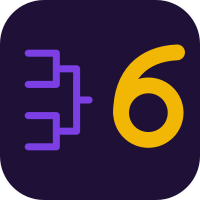

<p align="center">
  
</p>

<h1 align="center">Pick Six</h1>

<p align="center">
  <strong>Pick'em leagues and playoff brackets for you and your friends.</strong><br>
  NFL · NBA · NHL · MLB · MLS · NLL, on the real schedule, with live scores and a leaderboard.
</p>

<p align="center">
  <a href="https://derek1267.github.io/Pick-Six/"><strong>▶ Try it: derek1267.github.io/Pick-Six</strong></a>
</p>

---

## What it does

- **Private leagues.** Start a league, share the invite link or 6-letter code, and you're playing. Only members can see a league.
- **Real schedules.** Games, scores and results come in automatically. **NFL**, **MLS** and **NLL** leagues pick week by week (MLS lets you pick a draw). **NBA, NHL and MLB** leagues pick day by day.
- **Fair picks.** Every game locks at its own start time, and nobody can see anyone else's picks for a game until it starts. The rules are enforced by the database, not just the website.
- **Leaderboard.** One point per correct pick, a running season table, and a weekly winner.
- **Playoff brackets.** A full bracket for each sport with the final in the middle, using each league's real format:
  - NFL: 7 seeds per conference, with a bye and re-seeding.
  - NBA and NHL: 8 seeds per conference, best-of-7 series.
  - MLB: 6 per league, with byes for the top two.
  - MLS: 8 per conference, best-of-3 first round.
  - NLL: top 8 overall, single-game quarterfinals then best-of-3 semis and Finals.
  League brackets lock when the playoffs start and score 1 / 2 / 4 / 8 points by round.
- **🎲 Simulator and title odds.** Play out the bracket in one tap, or see each team's chances from thousands of simulated playoffs.
- **Build your own bracket.** Choose which teams make the playoffs and their seeds (the NBA version includes the play-in tournament), then fill it out or simulate it.
- **Predictions.**
  - *Final standings*: rank every team, scored live against the real table.
  - *Awards*: MVPs, rookies, coaches and executives, playoff MVPs and more.
  - *All-Stars*: full rosters per conference with starters, reserves and injury replacements.
  - *Year-end teams*: All-NBA, All-Defensive, All-Rookie, All-Pro, All-MLB and more.
- **Easy sign-in.** Continue with Google, or use an email link. No passwords.
- **Light and dark mode.** Follows your device, or flip it with the ☀/☾ button.

## How it's built

A small, free-to-run stack with no build step:

| Piece | Role |
|---|---|
| **HTML, CSS and vanilla JavaScript** (`index.html`, `app.js`, `bracket.js`, `styles.css`) | The whole front end, served by **GitHub Pages** |
| **[Supabase](https://supabase.com)** | Sign-in, a Postgres database, and row-level security rules that enforce pick locks and privacy |
| **GitHub Actions** + `scripts/sync-games.mjs` | Pulls schedules, scores and playoff seeds every 15 minutes, with a full-season refresh daily |

```
├── index.html            page shell
├── app.js                sign-in, leagues, picks, standings, brackets
├── bracket.js            playoff formats (incl. NBA play-in), simulator, odds and scoring
├── selections.js         award lists, All-Star and year-end rosters, standings scoring
├── styles.css            look and feel
├── logo.svg              the Bracket Six logo
├── config.js             your Supabase project URL and public key
├── supabase/schema.sql   tables, security rules and database functions
├── scripts/sync-games.mjs   schedule, score and seed sync
├── .github/workflows/    runs the sync on a schedule
└── docs/SETUP.md         how to run your own copy
```

## Ideas on the roadmap

- Confidence points and upset bonuses as league scoring options
- Survivor mode
- Pick reminders before the first game of each slate
- More sports (college football, WNBA)
- Plugging a real prediction model into the simulator

## Notes

- Schedules, scores and standings come from ESPN's public scoreboard feed. It's unofficial and could change without notice. Pick Six isn't affiliated with ESPN, the NFL, NBA, NHL, MLB, MLS or NLL.
- This is a just-for-fun project: no money, no betting.
